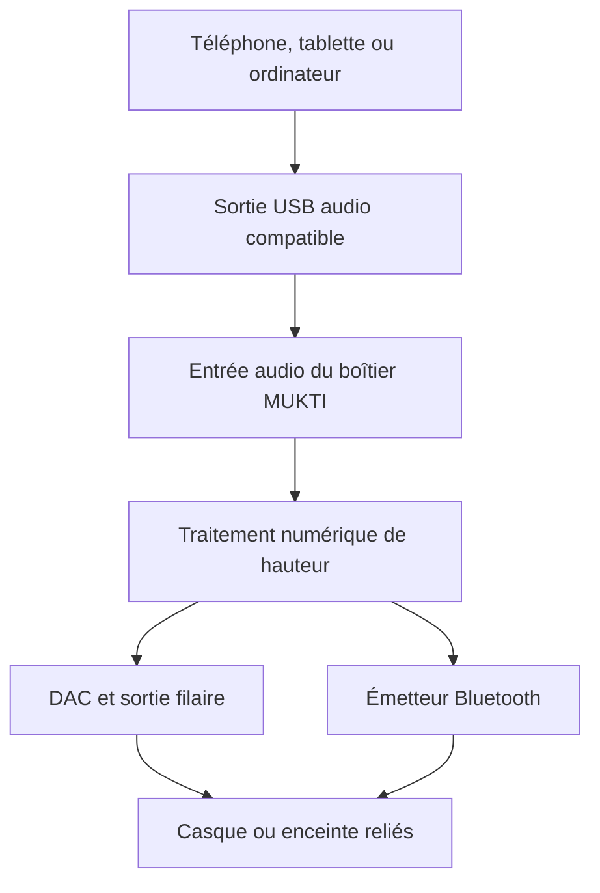

# MUKTI — Harmonie : réaccordage musical et fréquences audio

Date de conception : 6 novembre 2026, Europe/Paris.

## Résultat recherché

Étendre le module MUKTI de PURAMA ONE pour écouter des musiques et vidéos avec un diapason de référence à 432 Hz, produire une tonalité à fréquence choisie, écouter une mélodie accordée à ce diapason, ou mélanger volontairement une tonalité continue et une mélodie. Conserver les œuvres et leur rythme, traiter localement et utiliser les sorties audio compatibles du système.

La couverture maximale repose sur un moteur commun et plusieurs chemins d'accès au son. Une application mobile seule n'offre pas de modification universelle de toutes les applications et de tous les appareils.

## Existant vérifié et absence de doublon de produit

Le dépôt `puramapro-oss/mukti` possède `useSound432` dans `src/hooks/useMultisensorial.ts`, `ContinuousSoundMode.tsx` et `aurora-audio.ts`. Le premier crée une sinusoïde avec Web Audio. Ce code ne constitue pas un lecteur qui transpose une musique existante.

La branche `codex/mukti-432hz-measurement-20261025`, observée au commit `3cf8e05afac39da50706bce362a067eb8ca952fd`, contient `frequency-analysis.ts`, `local-frequency-meter.ts` et `FrequencyMeter.tsx`. Il s'agit d'une fonction de mesure. Son existence ne prouve pas qu'elle est déployée, ni qu'un microphone physique est étalonné.

La base `main` examinée est `1ead78251bf48df493fb9bca14e4cb90f2df1c9a`, arbre `4c9fd68bac2b7fa0c3a1ee1cfcbf866940a96d62`. Les ajouts de cette intervention sont isolés sous `prototypes/harmonie`, `tools/harmonie` et `docs`. Ils ne remplacent aucun écran de production ni générateur existant. Harmonie reste une fonction de MUKTI destinée à PURAMA ONE, pas une application commerciale supplémentaire.

## Ce que signifie 432 Hz

Une œuvre musicale contient un ensemble de fréquences. « Accordée à 432 Hz » signifie ici que la référence la4 est 432 Hz. Cela ne signifie pas que chaque note devient un son de 432 Hz.

Pour une source effectivement accordée au la4 = 440 Hz :

```text
rapport = 432 / 440 = 0.9818181818181818
décalage = 1200 × log2(rapport) = -31.766653633429282 cents
vitesse temporelle = 1
```

Le traitement est proportionnel : 440 devient 432, 880 devient 864 et 660 devient 648 Hz. Soustraire 8 Hz à chaque fréquence détruirait les rapports harmoniques. Ralentir simplement la lecture de ce rapport allongerait la durée de 1,85185 % ; le moteur doit dissocier la hauteur et le temps.

Le diapason source dépend de l'enregistrement, pas de la plateforme de distribution. Le réglage 440 est une hypothèse explicite lorsque la source n'est pas connue. Une source déjà accordée à 432 ne doit pas recevoir une seconde transposition. La détection automatique d'accordage serait une estimation avec confiance, à développer et qualifier séparément.

Une transformation de hauteur modifie nécessairement le signal. L'objectif est de conserver arrangement, mélodie relative, rythme, paroles et durée, avec des artefacts limités ; l'identité numérique avec l'original n'est pas un objectif possible.

## Fonctions et présentation

| Fonction | Traitement | Information affichée |
|---|---|---|
| Musique réaccordée | Transposition de la source vers le diapason cible, temps constant | Source supposée ou renseignée, cible, état réel du moteur |
| Tonalité seule | Oscillateur sinusoïdal | Fréquence demandée, durée, volume numérique |
| Mélodie accordée | Notes calculées avec la4 = 432 Hz | Diapason de la mélodie ; aucune affirmation de tonalité continue |
| Mélodie + tonalité continue | Deux sources mélangées avec niveaux séparés | Présence explicite du son continu, fréquence et volume propres |
| Mesure | Analyse d'un signal effectivement acquis | Mesure, incertitude et source distinctes de la consigne |

Une lecture ne démarre qu'après action explicite. Les attaques et arrêts sont progressifs. Prévoir minuterie, arrêt immédiat, gestion des interruptions et nettoyage des ressources. Les réglages de volume numériques ne représentent pas des décibels acoustiques mesurés au tympan.

## Moteur local et choix techniques

### Lecteur web et moteur commun

Le prototype utilise Signalsmith Stretch 1.3.2, version officielle WebAssembly/AudioWorklet, sous licence MIT. La copie du moteur est embarquée ; aucun CDN ni appel à un service d'IA n'est requis à l'exécution. Conserver la licence et la provenance avec les sources.

Paramètres du mode de transposition proportionnelle :

```js
{
  semitones: 12 * Math.log2(targetHz / sourceHz),
  rate: 1,
  tonalityHz: 0,
  formantCompensation: false
}
```

`tonalityHz: 0` évite la courbe non proportionnelle dans les aigus du réglage par défaut. La compensation des formants pourra faire l'objet d'un mode voix après essais perceptuels ; elle ne doit pas être présentée comme un gain universel sur les mixages polyphoniques.

Le prototype utilise une sortie stéréo explicite. L'initialisation doit expirer proprement en cas d'erreur de moteur, et un échec du processeur doit interrompre la séance. Aucun état « actif » ne doit être déduit de la seule valeur d'un bouton.

Les essais numériques ont conduit à retenir l'entrée PCM en continu du moteur, alimentée par un `AudioBufferSourceNode` à vitesse 1, avec blocs de 320 ms et intervalle de 80 ms. La latence propre du processeur annoncée par son API est de 320 ms dans cette configuration ; les délais de sortie du système et du périphérique s'y ajoutent. Le mode de lecture par buffers du moteur n'est pas retenu : il produisait environ 432,508 Hz sur la fixture 440 Hz. Le mode continu retenu produit environ 432,045 Hz et reste une transposition musicale approchée, distincte du générateur direct de tonalités. Les résultats exacts, critères et réglages sont conservés dans `prototypes/harmonie/tests/verification.json`. Ce choix ne valide pas le fonctionnement dans un navigateur réel ni une synchronisation vidéo en direct.

Le traitement ne nécessite pas de GPU cloud ni de jetons de modèle. Les coûts subsistants sont développement, qualification, distribution, consommation locale et éventuel matériel. Cette observation technique ne modifie pas les décisions de tarification ou de quotas de PURAMA ONE.

### Conversion des fichiers audio et vidéo

L'outil `tools/harmonie/retune.py` utilise une installation locale de FFmpeg disposant du filtre Rubber Band. Le moteur audio transforme la hauteur à tempo constant ; la vidéo est copiée sans réencodage lorsque le conteneur et le codec sont compatibles. Le fichier d'origine est conservé. Les restrictions exactes et commandes sont documentées avec l'outil.

Cette voie sert aux fichiers locaux accessibles et autorisés. Elle ne télécharge ni ne déchiffre les catalogues des plateformes. Elle ne remplace pas un filtre de sortie système en temps réel.

Le moteur web MIT et l'installation FFmpeg/Rubber Band sont deux dépendances distinctes. Le second n'est pas redistribué dans cet ajout. Une distribution commerciale embarquant ses binaires doit respecter les licences correspondantes ; ce prototype ne constitue pas une validation de distribution App Store d'un binaire Rubber Band.

## Couverture des appareils

| Famille | Lecteur MUKTI / générateur | Son des autres applications | Chemin à développer ou qualifier |
|---|---|---|---|
| iPhone / iPad | Réalisable dans notre propre chaîne audio | Pas de filtre système universel fourni par une application standard | Lecteur local, moteur natif ou WebAudio ; accessoire audio externe si le son y est effectivement envoyé |
| Android | Réalisable dans notre lecteur | Capture partielle, autorisations et politique de l'application source ; copie du son, pas remplacement automatique | Media3/NDK pour notre lecteur ; adaptations système seulement lorsqu'elles sont réellement permises |
| macOS | Réalisable | Core Audio taps sur sorties accessibles avec consentement et routage | Capturer les sources choisies, couper leur sortie originale, exclure notre propre sortie et traiter avant restitution |
| Windows | Réalisable | Traitement possible sur une chaîne audio appropriée | Périphérique virtuel ou APO ; loopback seul ne constitue pas un insert |
| Linux | Réalisable | Traitement des flux routés par PipeWire | Sortie virtuelle filtrée et graphe audio vérifié |
| TV / consoles / appareils fermés | Selon capacités d'installation et formats | Selon sortie accessible et protections | Processeur externe sur une sortie audio compatible |

Cette matrice décrit des possibilités d'architecture documentées, pas des validations matérielles obtenues pendant cette intervention. Les flux protégés, modes exclusifs, appels, microphones, audio spatial et sorties multicanales nécessitent leur propre qualification.

### Particularité Android

AudioPlaybackCapture nécessite notamment une autorisation explicite MediaProjection et une politique source permettant la capture. L'application source peut l'interdire. Copier puis rejouer l'audio sans contrôler la première sortie peut faire entendre simultanément l'original et la version transposée. Une démonstration de capture ne prouve donc pas un filtre universel utilisable.

### Particularité iPhone / iPad

`AVAudioUnitTimePitch` permet de traiter l'audio dans notre moteur en réglant hauteur et vitesse séparément. `mixWithOthers` permet seulement de mélanger notre session avec une autre. ReplayKit n'est pas un point d'insertion DSP universel et transparent. Les API publiques examinées ne permettent donc pas de promettre la transformation de toutes les autres applications vers tous les haut-parleurs internes par un simple réglage MUKTI.

## Casques, écouteurs, enceintes et marques

Lorsque le son est traité avant la sortie, le casque ou l'enceinte reçoit déjà ce signal. Il n'a pas besoin d'un mode propriétaire « 432 ». Ce sont le protocole, le rôle audio, le format, la route et le comportement de l'appareil qui déterminent la compatibilité.

La sortie filaire, le haut-parleur local ou une sortie Bluetooth du système sont des routes distinctes à essayer. Une marque reconnue ne permet pas d'affirmer que tous ses modèles et firmwares fonctionnent. Les appels et le micro de casque peuvent utiliser une autre route/profil que la musique.

Spotify Connect et certaines lectures Cast sont des commandes de lecture distante : l'enceinte ou la TV peut recevoir directement son flux. Un traitement sur le téléphone ne modifie pas un flux qui le contourne. AirPlay doit être classé selon le comportement réel : émission de notre audio, lecture distante ou transfert de lecture. Afficher « lecture distante : traitement non confirmé » lorsque la route sort de notre chaîne.

## Accessoire MUKTI proposé

Architecture à prototyper :



Le boîtier doit se présenter comme un véritable périphérique USB Audio. Le connecteur USB-C seul ne donne pas cette fonction. La sortie vers des écouteurs Bluetooth nécessite le rôle émetteur/source ; un simple récepteur ne convient pas. Commencer par une entrée USB et une sortie filaire, puis ajouter la sortie Bluetooth. Une entrée Bluetooth supplémentaire ajoute une réception, un décodage et des contraintes de tampon/horloge.

Le casque doit recevoir le son du boîtier. Cette architecture ne modifie pas le haut-parleur interne du téléphone et ne traite pas une enceinte lisant directement depuis le cloud. Elle n'est pas un procédé de contournement de protections. Compatibilité USB, alimentation, recharge simultanée, reconnexion, latence et volume restent à mesurer sur chaque configuration retenue.

## Spotify et autres plateformes

Les conditions développeur de Spotify restreignent l'altération de son contenu et la superposition avec d'autres contenus. Le Web Playback SDK nécessite un accord écrit préalable pour les projets commerciaux. Une API de télécommande ne fournit pas automatiquement les échantillons audio à notre moteur.

Le projet ne doit donc pas afficher « Spotify intégré en 432 Hz » comme fonction acquise. Une fonction générique de traitement local de sortie est techniquement différente d'une intégration utilisant le SDK Spotify ; les documents développeur cités ne suffisent pas à qualifier toute écoute personnelle avec un DSP. Toute intégration commerciale spécifique doit être examinée selon son fonctionnement et les accords effectivement obtenus.

Pour chaque autre plateforme, vérifier séparément accès au flux, protections, intégration autorisée et route réelle. Ne pas extrapoler un succès sur un fichier local à Netflix, YouTube, Apple Music, Deezer ou à leurs applications natives.

## Latence et fidélité

Le tempo constant n'élimine pas le retard de traitement. Un lecteur vidéo contrôlé par MUKTI peut compenser une latence connue dans son horloge audiovisuelle. Un processeur de sortie externe ne contrôle pas nécessairement l'image affichée par une autre application. Ne pas promettre une synchronisation parfaite sur toutes les vidéos ni « zéro latence ».

Les objectifs de qualification sont : pas de dérive de durée, pas de sortie originale doublée, stéréo conservée, absence d'écrêtage, transition propre, et retard mesuré. Une comparaison à l'aveugle, à niveau comparable, sur voix, piano, cordes, percussion et basses complète les mesures numériques. La réussite de tons synthétiques ne certifie pas la qualité perceptuelle de toutes les musiques.

## Validation et états à conserver

Les preuves produites durant cette intervention doivent être reliées aux résultats machine et à leur environnement. Les résultats historiques ne sont pas comptés comme des tests réexécutés.

- **PASS** : test effectivement exécuté et critère rempli, avec résultat numérique ou trace vérifiable.
- **PARTIEL** : fonctionnement établi dans un périmètre limité.
- **BLOQUÉ** : dépendance ou autorisation indispensable absente.
- **NON TESTÉ** : aucune preuve d'exécution dans l'environnement concerné.

La validation numérique doit inclure 440→432, 880→864, 12 000→11 781,818 Hz, source déjà à 432, séparation des canaux et durée. La conversion vidéo doit également vérifier que les images n'ont pas été réencodées et que le décalage audio/image n'a pas dérivé.

Le signal mesuré dans des buffers numériques est distinct du son réellement émis par un transducteur. L'horloge du convertisseur, le système, le casque et la mesure physique introduisent leurs propres limites. Un microphone de téléphone peut aider à repérer un ton dominant ; il ne certifie pas à lui seul l'accordage complet d'une musique polyphonique ni une exactitude métrologique.

## Intégration à terminer dans l'environnement produit

1. Rapprocher la branche MUKTI active et les travaux de mesure existants, sans dupliquer les générateurs. Le prototype isolé est un banc de validation ; extraire le moteur partagé dans la chaîne de production choisie.
2. Reprendre les contrôles MUKTI existants pour activation, volume, arrêt, interruptions et préférences. Ajouter le lecteur à la navigation PURAMA ONE, puis vérifier le build réel et les parcours applicatifs.
3. Vérifier Safari/iPhone et iPad réels, Android réel, macOS et Windows. La présence d'AudioWorklet dans un navigateur n'est pas un essai de notre application.
4. Développer et qualifier le routage système Mac en premier pour le MacBook Pro de Matiss, puis Windows/PipeWire selon la distribution souhaitée.
5. Prototyper l'accessoire USB Audio avec un matériel documenté ; mesurer filaire avant Bluetooth. Aucun achat ni fabrication n'a été engagé par cette intervention.
6. Valider séparément les intégrations de plateformes et leurs conditions. Un blocage sur une plateforme ne bloque pas le lecteur local ni le générateur.

## Sources primaires consultées

- Apple, hauteur/vitesse indépendantes : https://developer.apple.com/documentation/avfaudio/avaudiounittimepitch
- Apple, unité en cents : https://developer.apple.com/documentation/avfaudio/avaudiounittimepitch/pitch
- Apple, mélange de sessions : https://developer.apple.com/documentation/avfaudio/avaudiosession/categoryoptions-swift.struct/mixwithothers
- Apple, Core Audio taps : https://developer.apple.com/documentation/coreaudio/capturing-system-audio-with-core-audio-taps
- Android, capture de lecture et restrictions : https://developer.android.com/media/platform/av-capture
- Microsoft, architecture APO : https://learn.microsoft.com/windows-hardware/drivers/audio/audio-processing-object-architecture
- PipeWire, chaînes de filtres : https://docs.pipewire.org/page_module_filter_chain.html
- Signalsmith Stretch, moteur et licence : https://github.com/Signalsmith-Audio/signalsmith-stretch
- Signalsmith WebAudio : https://github.com/Signalsmith-Audio/signalsmith-stretch/blob/88061fd4eda56a2353c5d65c74aa3f4ccf76f9da/web/release/README.md
- FFmpeg, filtre Rubber Band : https://ffmpeg.org/ffmpeg-filters.html#rubberband
- Spotify, conditions développeur : https://developer.spotify.com/terms
- Spotify, politique développeur : https://developer.spotify.com/policy
- Spotify, SDK web : https://developer.spotify.com/documentation/web-playback-sdk
- Spotify Connect : https://support.spotify.com/us/article/spotify-connect/
- Bluetooth SIG, A2DP : https://www.bluetooth.com/wp-content/uploads/Files/Specification/HTML/a2dp_v1-4-1_1752513648/A2DP_v1.4.1/out/en/index-en.html
- W3C, oscillateurs Web Audio : https://www.w3.org/TR/webaudio-1.0/#OscillatorNode
